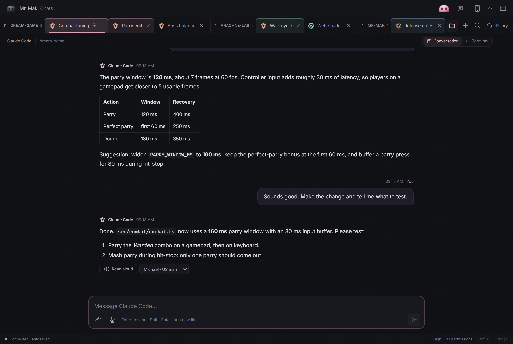
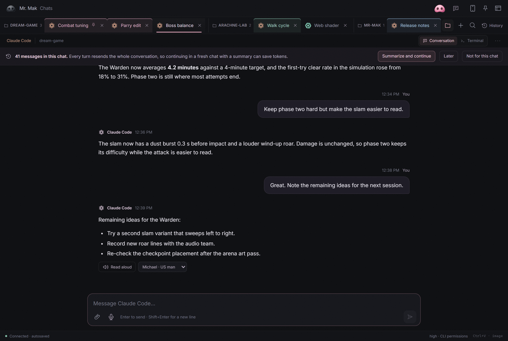
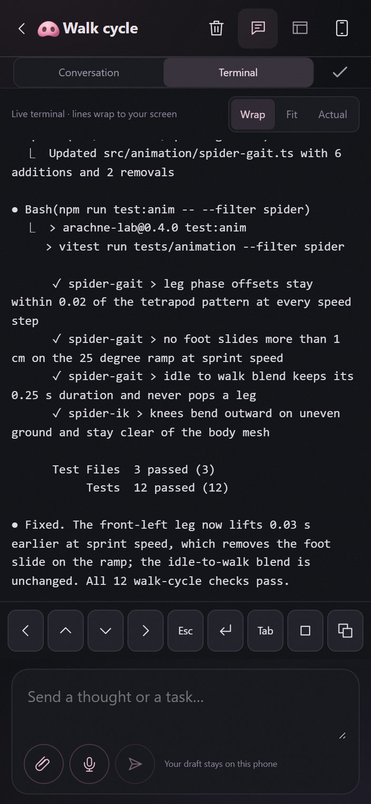

# Mr. Mak Workspace

Your CLI agents, a visual Workspace, and access from your phone.

Mr. Mak has **two connected desktop windows**:

- **Chats** is where you give tasks to Codex, Claude Code, Antigravity, OpenCode, Kimi or Pi. Each
  conversation runs in a real CLI terminal, with its own tab and saved history.
- **Workspace** is where you review the results: project pages, research, images,
  saved prompts and reports. Files, skills, MCP connections and settings sit
  alongside your work.

Keep the windows side by side, or minimize either one independently. You can
leave Chats in view while working in Blender, a game engine or your browser.

**New in 0.6: [edit Workspace cards yourself](docs/editable-cards.md).** Add
images, notes and prompts in Gallery or Research views. Agents use the same
content files. You can also [connect your phone](#on-your-phone) to follow chats,
send ideas and dictate messages while the agents keep working on your computer.


*Chats on the left, Workspace on the right. App views arranged side by side
with sample conversations and the included My Dream Game project.*

## Read and answer a chat as a conversation

Claude Code and Codex chats have a **Conversation | Terminal** switch. The
Conversation view reads the CLI's own transcript and shows it as messages, with
Markdown, images and recent tool activity. Its composer sends text, attachments
and dictation to the same terminal, and **Stop** (Esc) interrupts the agent.



A new chat opens in Terminal until it has a conversation, so folder-trust and
sign-in questions are never hidden. Links to local files in a reply open a
Workspace preview, resolved against the chat's folder.

- **Answer permission menus with a click.** When the CLI asks for permission,
  the numbered menu at the bottom of the terminal appears as buttons. Before
  sending any key, Mr. Mak reads the screen again and checks that it is still the
  same prompt, so a late click cannot answer a newer question.
- **Autocomplete commands.** Type `/` at the start of a message, or `$` before a
  word in a Codex chat, to list that CLI's built-in commands plus project, user
  and plugin commands and skills. A command that opens a picker, such as
  `/model`, switches the chat to Terminal after it is sent.
- **Edit a sent message.** In a Claude Code chat, the pencil on your message
  opens an editor, as with Esc Esc in Claude Code. Sending rewinds the
  conversation to before that message (files are not changed) and sends the
  edited text. After a rewind, including one made in the terminal, the view shows
  only the current branch.
- **CLI events stay compact.** Background agent results, slash commands and their
  output appear as short events instead of raw tags; a review's findings become a
  list with file links. Choose Compact, Expanded or Hidden in chat options.
- **See what is still running.** For Claude Code chats, a line above the composer
  counts the subagents and background terminal commands that are still working.
  Expand it to see each agent's task and current step, each command and who
  started it, and how long each has been running.
- **Know the model.** The status bar shows the model the chat last used, next to
  reasoning effort and permissions.
- **Read aloud on the desktop** with the same local voices as the phone.
  *Preparing audio…* shows while your computer generates each part.


Codex 0.163 chats are supported: Mr. Mak starts Codex with `--no-daemon` when
the installed version offers it, so every chat stays linked to its conversation,
and a chat follows a rewind or a `/new` made in its terminal.

## Workspace and Chat themes

Choose independent themes for Workspace and Chat in **Settings → Appearance**,
or use the Chat header's Appearance button. Thirteen named palettes include
**Codex / ChatGPT**, **Antigravity** and **Claude Code**, plus light and dark
variants of **Nordic**, **Forest**, **Sandstone**, **Ocean** and **Plum**.
Dark, Light and System remain available.

Workspace themes also style standard reports. Chat themes cover Conversation
and Terminal while retaining drafts and terminal connections. Choices save and
sync across open windows. See the [palette list](desktop/README.md#workspace-and-chat-themes).

## Projects and long chats

**New chat** lists the folders you have worked in: the Workspace, projects
opened in Claude Code, folders where Codex ran and folders of earlier Mr. Mak
chats. Pin favorites to keep them at the top. History can filter by project, and
the voice coordinator can open a chat in a project you name. A paired phone may
only start a chat in a listed folder, never in an arbitrary path.


After a set number of your messages (40 by default; chat options **⋯**), a chat
offers **Summarize and continue**. Mr. Mak asks the agent for a handoff, saves it
in `inbox/handoffs`, and opens "*name* · continued" in the same folder with the
same agent and settings. The new chat starts by reading that handoff. Choose
**Later** or **Not for this chat** to dismiss it.



Choose a group in **New chat**, or right-click a tab to create or join one.
Group headers can be dragged, collapsed, renamed and coloured. Deleting a group
keeps its chats, including those in History. Pinned tabs stay ahead of other
tabs. Double-click a tab, or press F2, to rename its chat.

## On your phone

Read replies, send follow-ups or images, and open Workspace reports from a mobile
web app you can add to your Home Screen. The phone connects to Mr. Mak on your
computer through **Tailscale**. Your agents keep running on the computer with
their existing CLI accounts.

<a href="docs/assets/mobile-overview.png"></a>

*Your chats, a conversation, and voice input in one overview. Tap the image
to see it at full size. Sample conversations shown.*

- **Pair from Chats.** Press the phone button on your computer, enable mobile
  access, scan the QR code and confirm the matching code on the desktop.
- **Pick up where you left off.** Pair once, then reopen the same phone shortcut.
  Phone and desktop can show different chats while sharing the conversation.
- **Speak a draft.** Tap the microphone, record your message and stop to
  transcribe it. Review the text before pressing Send.
- **Review the result.** Enlarge shared images, play videos, or reopen a report
  at its saved position. Optional local voices can read a reply aloud.
- **Move around like an app.** Pull down from the top of the Workspace to
  refresh it; an open report reloads at the same page and section. The back
  gesture returns to the previous screen instead of leaving the app (Chrome and
  Edge on Android).
- **Read the terminal.** The Terminal view opens in Wrap mode, so the live text
  wraps to the screen and can be selected. Fit and Actual remain available.



Keep the computer awake with Mr. Mak running, and Tailscale connected on both
devices. Dictation can run locally with Whisper after the optional Python setup,
or use separately billed OpenRouter/OpenAI API credit. Updates keep your current
provider. Local dictation and Read aloud require no transcription API key;
the optional Live voice coordinator still uses OpenAI API billing.

[Set up mobile access and voice input](docs/mobile-access.md)

## Everyday tools


- **Cards you can edit yourself.** Choose **+ New card** for a Gallery or Research
  page. Add images, notes, source links and prompts; drag entries into order or
  use the arrow buttons. Preview and save without asking an agent. Agents work
  with the same local content files, and the editor checks for conflicting edits.
  Existing HTML reports keep their own layouts. [How editable cards work](docs/editable-cards.md).
- **Your files, close at hand.** Browse a folder tree with Main folders or All
  files, jump to `inbox`, `projects`, `workspace`, `knowledge` and `processes`,
  and open any folder in Windows Explorer, macOS Finder or your file manager.
- **Readable notes you can edit.** Open Markdown as a formatted document, switch
  to Edit, and save changes in the same window. Preview images, video and audio
  alongside the file tree.
- **Choose a reading theme.** Settings > Appearance offers Dark, Light and
  System. Light uses dark text on white across Workspace and standard reports.
  Images keep their original colors; terminal appearance is set separately.
- **Chats you can return to.** Pin conversations in history, reorder and color
  tabs, and see which agents are working or have a reply you have not viewed.
  Drop files or folders into a chat to insert their paths; clipboard images are
  saved in `inbox/attachments`.
- **Projects with their work attached.** Keep research, design versions, saved
  prompts and motion tests in tabs inside a card. Open images at full size and
  download them from the preview. In the desktop app, click a card's status dot
  to change its status or category, pin it, or archive it. Restore archived cards
  from search or Show archive; their files and tabs stay in place.
- **Skills and tools within reach.** The right rail opens project skills,
  knowledge, workflows, MCP connections, Settings and Help. See which MCP
  connections come from the project and which come from your agent's global setup.


## Before you start

**Prerequisite: install and configure Codex CLI, Claude Code CLI, Antigravity, OpenCode, Kimi
or Pi before setting up Mr. Mak.** You need at least one. They can run side by side
and are separate installations, not bundled with Mr. Mak.

- [Install Codex CLI](https://developers.openai.com/codex/cli)
- [Install Claude Code CLI](https://code.claude.com/docs/en/setup)
- [Install OpenCode](https://opencode.ai/docs/)
- [Install Antigravity CLI](https://www.antigravity.google/docs/cli/install/)
- [Install Kimi Code CLI](https://moonshotai.github.io/kimi-cli/)
- [Install Pi](https://pi.dev/)

**Do I need an API key?** No, not for Claude Code or Codex chats when you sign
in with an eligible subscription. Mr. Mak runs the real CLI with its existing
login: Claude Pro/Max can use Claude Code, and Codex can use ChatGPT subscription
access. Normal plan limits still apply. API billing is an alternative, not a
requirement. See [Claude authentication](https://code.claude.com/docs/en/authentication)
and [Codex authentication](https://developers.openai.com/codex/auth).

**OpenCode** uses the providers and authentication you configure in OpenCode.
Their access and billing rules still apply; support here does not turn a Claude
Code subscription into OpenCode API access. Choose **+ > OpenCode** in Chats.

**Antigravity** runs Google's `agy` CLI in a chat tab. Install it from the
[official guide](https://www.antigravity.google/docs/cli/install/), then choose
**+ > Antigravity**, sign in and use `/model` to select an available model.
Google controls model access and usage limits. History resumes the exact
conversation recorded for that tab. Antigravity currently uses the terminal
view on phones; structured replies and completion badges are not available yet.

The optional voice coordinator specifically requires **Codex CLI** and your own
**OpenAI API key**. Voice API usage is billed separately. Leave voice off to use
subscription-backed CLI chats without an API key.

## Start with an agent

Use **Use this template** on GitHub to create your own repository, then clone it
into a folder you control. Open that folder in your installed Codex CLI,
Claude Code CLI or OpenCode and paste:

> Set up this Mr. Mak Workspace repository on my computer. Read AGENTS.md and
> docs/getting-started.md, check the prerequisites, and help me run the desktop
> app for my operating system. Use my own CLI accounts. Leave optional voice,
> paid providers, MCP connections and the window-recall shortcut (Win key on
> Windows) off until I choose to connect them.
> Keep my credentials in the ignored .env file. Show me the four examples and
> help me replace them with my own project.

The repository includes examples, instructions and application source. You bring
your own agent accounts and any services you want to use.

## Run the desktop app

On Windows, download the installer from [Releases](https://github.com/witnesstodark/mr-mak-workspace/releases/latest),
install **Mr. Mak Workspace**, then open **Start Mr. Mak.cmd** in your cloned
repository. On Linux, build the Tauri desktop target after installing the Node,
Rust and WebKitGTK prerequisites, then launch the resulting AppImage/deb install
with `--repo /path/to/your/workspace`. On macOS (Apple Silicon), download the
`.dmg` from the same Releases page or run `./setup.sh desktop` to build
`Mr. Mak Workspace.app`, then open **Start Mr. Mak.command**
([macOS notes](docs/getting-started.md#macos)). On every system, use **+** in
Chats to open an installed CLI and sign in with your own account.

The installer includes the local Node service. It does not include Codex,
Claude Code, Antigravity, OpenCode, Kimi, Pi, Blender, Python or provider accounts.

**Already using Mr. Mak?** Read the [update notes](CHANGELOG.md) for the
Conversation view, recent projects and fresh-chat handoff, and for 0.5.1's
Antigravity, macOS improvements, mobile navigation, local voice options and
release security changes.
Follow the
[update guide](docs/updating.md) to update the app and add skills to your existing
repository without replacing your projects.

To build from source, install Node.js 22.20+ and the Tauri build prerequisites
for your operating system, then run on Windows:

```powershell
powershell -ExecutionPolicy Bypass -File .\Setup.ps1 -Mode Check
powershell -ExecutionPolicy Bypass -File .\Setup.ps1 -Mode Desktop
```

On macOS or Linux:

```bash
./setup.sh check
./setup.sh desktop
```

For a browser preview of the reports, use `-Mode Preview` (macOS/Linux:
`./setup.sh preview`) with Node.js 22.20+ and npm. Rust and C++ Build Tools are needed only to compile the native desktop
app; they are not required for Preview or the downloaded installer. The native
desktop app adds managed terminals, local file operations and voice.
See [getting started](docs/getting-started.md) for the complete setup and
[architecture](desktop/README.md) for the source layout.

## What is inside

| Example | What it demonstrates |
| --- | --- |
| **My Dream Game** | Mr. Mak 64: an illustrated game hub with an intro screen, character studies, locations and a development board. |
| **Creative MCP Connections** | A researched connection shortlist, source links and a practical setup checklist. |
| **Make Workspace Yours** | Getting started, everyday use and changes you can ask an agent to make. |
| **Arachne Character Lab** | Versions 1 through 9, expandable saved prompts, 158 images and eight motion studies. |

The examples stay visible until you archive them. Create your own cards next to
them, or archive all four when you are ready.


Terminal text settings let you adjust readability. In agent chats, Ctrl+C copies
selected text; PowerShell keeps normal shell behavior. On macOS, ⌘C and ⌘V copy
and paste, and Ctrl+C reaches the CLI as in Terminal.app.
Click web links in chats or cards to open your default browser. New Codex and
Claude chats start with `xhigh` effort; saved effort choices are preserved.
OpenCode keeps its own model and reasoning configuration.

## Optional asset delivery evidence

Asset deliveries can carry a local SHA-256 manifest. The offline
[asset delivery tool](scripts/asset-delivery/README.md) records inputs and outputs
for a card without changing existing cards. Verification checks file integrity;
visual approval and engine readiness remain separate decisions.

## Skills you can keep

Twenty project skills cover planning, handoffs, Workspace reports, image
references, fal.ai generation, Higgsfield workflows, character sheets, procedural
Three.js modeling, materials, motion references, Blender game animation, video
inspection and dictation setup. Game workflows cover **VFX, UI, animation
integration, level design, audio and native visual review**. Read the
[skill index](docs/skills.md), or take the separate skills ZIP from the release
into another project.

The maintained instructions live in `.agents/skills`. Complete copies in
`.claude/skills` include the same instructions and resources. Both agents get the
full skills. Run `npm run skills:sync` after editing the maintained source.
Copy a skill together with its referenced resources; keep `.env`, job receipts
and account configuration private.

## Optional voice and connections

You can work entirely through the CLI chats. The floating nose adds an optional
voice assistant: OpenAI Live supplies the voice connection over API, and the
coordinator uses your signed-in Codex CLI. Voice API usage is billed separately
from a CLI subscription. The coordinator uses your Codex model configuration
unless you set `MRMAK_COORDINATOR_MODEL` in `.env`.

fal.ai, Higgsfield and other providers are optional and use your own accounts.
MCP configuration starts empty. The MCP panel explains where connections are
configured, including any global connections your existing agents already have.
The research sample is a shortlist, not a claim that those tools are installed.

## Make it yours

Edit the placeholder files in `context/`, keep reusable lessons in `knowledge/`,
and save workflows in `processes/`. English is the default for stored content;
ask for another language whenever you need it. The app's window-recall shortcut
(Win key on Windows) and permission bypass both start disabled.

Desktop source builds support **Windows x64, Linux and macOS**. The Mac app is
ad-hoc signed (not notarised) and Apple Silicon only; see the [macOS setup and limitations](docs/macos.md) before installing.
See [customization](docs/customization.md) and
[sharing your version](docs/sharing.md).

Application code and original workflow documentation are under the MIT license.
Bundled third-party skill materials keep their original licenses. Sample media
is supplied for learning and remixing; see [third-party notices](THIRD_PARTY_NOTICES.md).

---

Mr. Mak is small.


